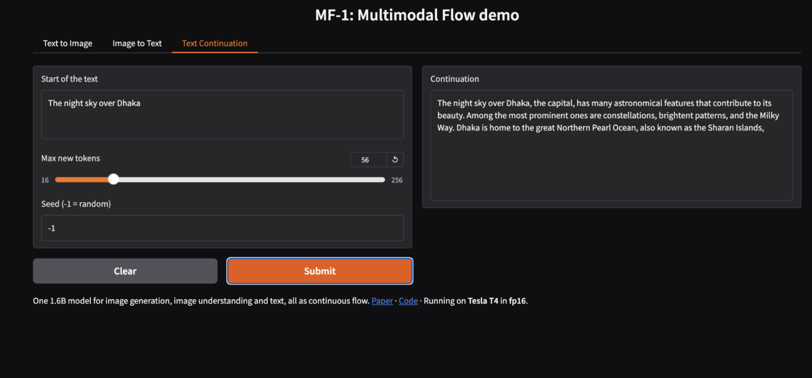
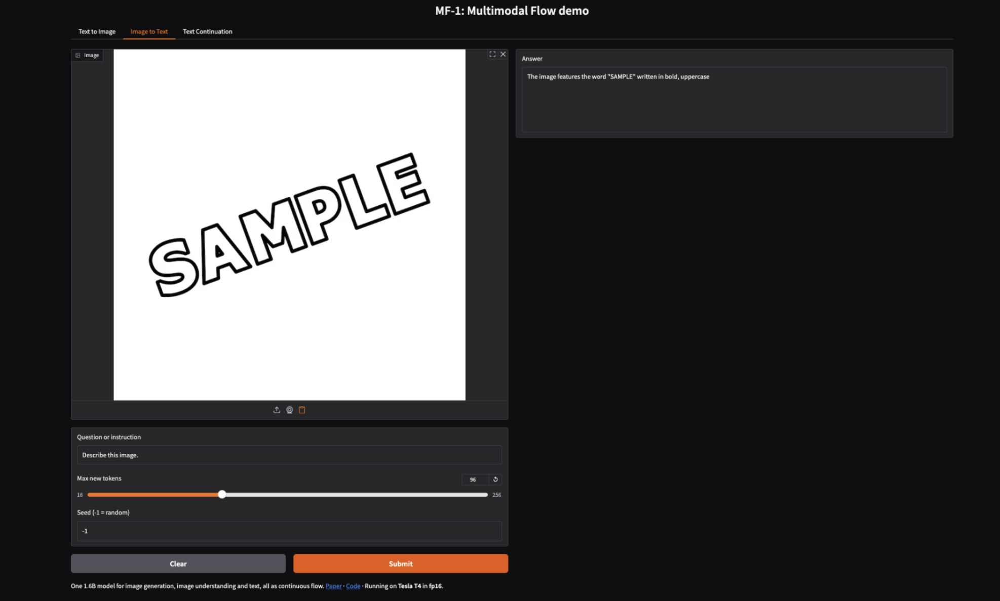
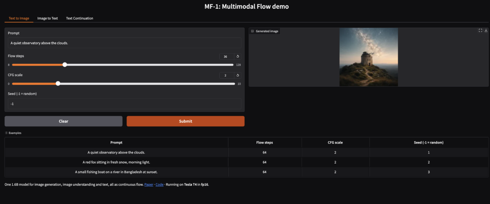

# MF-1 Gradio demo

A Gradio web demo for [MF-1 (Multimodal Flow)](https://github.com/hustvl/Multimodal-Flow), built following the
[Gradio quickstart](https://www.gradio.app/guides/quickstart): each task is a plain Python function wrapped with
`gr.Interface`, shown as tabs, and launched with `share=True` for a public link.

Tabs:
- **Text to Image**: prompt, flow steps, CFG scale, seed
- **Image to Text**: upload an image and ask a question or ask for a caption
- **Text Continuation**: give the start of a text and MF-1 continues it

It runs on new GPUs in bf16 and on older GPUs like the free T4 on Kaggle or Colab in fp16 (weights stay in fp32).

## Screenshots
Running on a free Kaggle T4 GPU.







## Run on Kaggle (free)
Open `MF1_gradio_kaggle.ipynb` on Kaggle, turn on GPU T4 x2 and Internet, then Run All in the editor.

## Run on your own GPU
```bash
git clone https://github.com/hustvl/Multimodal-Flow.git && pip install -e Multimodal-Flow
pip install "gradio==5.49.1"
huggingface-cli download hustvl/Multimodal-Flow --local-dir MF_weights
huggingface-cli download nyu-visionx/siglip2_decoder --local-dir assets/scale_rae_decoder
export MF_CHECKPOINT=$PWD/MF_weights/MF/sft MF_ASSETS_ROOT=$PWD/assets
python app.py --share
```

Gradio is pinned to 5.49.1 because MF-1 needs `transformers==4.57.1`, which needs `huggingface-hub<1.0`,
and Gradio 6 needs `huggingface-hub>=1.16`.
